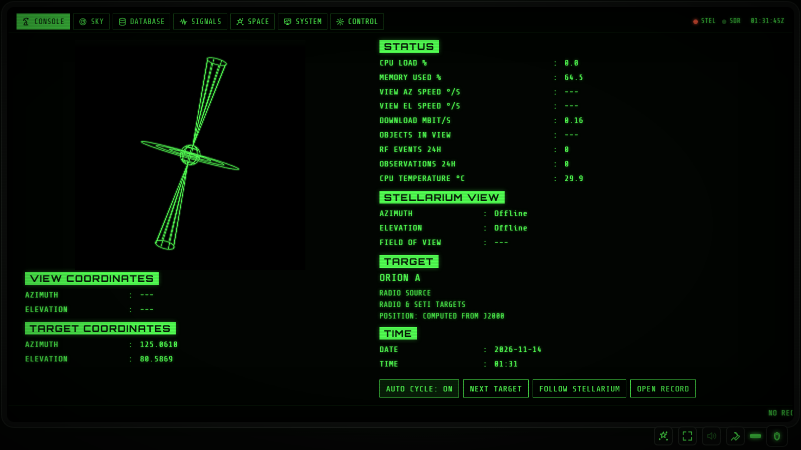
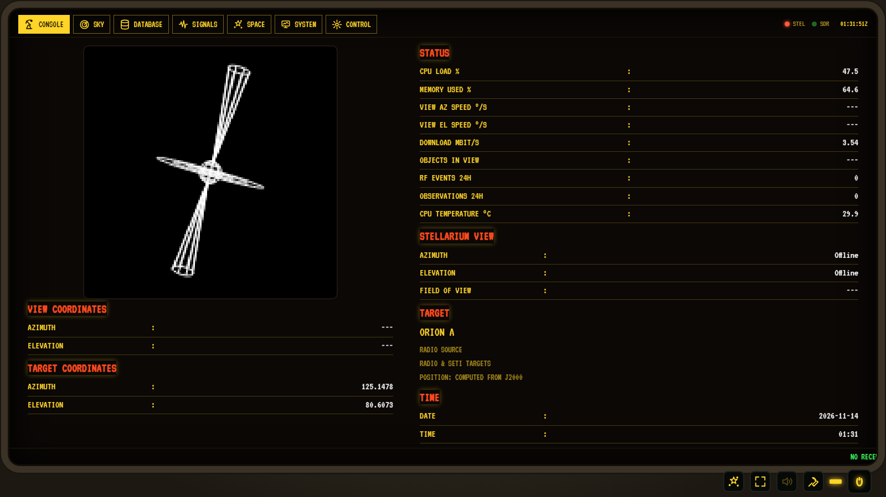

# stellarium-votv-signalsim-panel

A retro radio-telescope console for your home network. It hooks into **Stellarium**, an optional **RTL-SDR** dongle and public space and shortwave data. You can choose between phosphor-monitor and terminal themes inspired by *Signal Simulator* and *Voices of the Void*.

Open it in any browser on your LAN, such as a laptop, tablet or wall screen. It shows what Stellarium is looking at, keeps a log of what you observe and turns radio sweeps into a signal log. It also plays a fully synthesized console soundscape.




> Fan project; not affiliated with or endorsed by the developers of Signal Simulator or Voices of the Void.

---

## Features

| Screen | What it shows |
|---|---|
| **Console** | The live Stellarium view (azimuth, elevation, field of view and how fast it is turning), a rotating 3D hologram of the current target, PC load, and an auto-cycle through interesting objects above your horizon. |
| **Sky** | An alt-az radar of everything above the horizon down to a chosen magnitude, plus planets live from Stellarium, filters by object type and your latest Stellarium screenshot. |
| **Database** | Everything the panel knows about: the Stellarium catalogue (Messier, Caldwell, comets, meteor showers, novae and more), a curated list of radio and SETI targets, and every object you have observed. |
| **Signals › RF** | Your RTL-SDR as a band monitor. It shows the noise floor per band, the latest sweep spectrum and a log of signals that rise above the floor. |
| **Signals › Shortwave** | A live numbers-station schedule (Priyom) and always-on stations. One click tunes a public KiwiSDR or WebSDR receiver to the frequency. |
| **Space** | The latest NASA and JAXA images and posts: Mars rover raw images, DSCOVR EPIC Earth, SDO and SOHO Sun, APOD, Himawari, ISAS and JAXA news. |
| **System** | CPU, memory, disks, network and temperatures, which of Stellarium, SDR#, SDR++, GQRX and rtl_tcp are running, and history charts. |
| **Control** | Optional, protected by a PIN. Point Stellarium at an object or alt-az position, or change its field of view. Your own view is restored automatically after a few idle minutes. |

**What counts as an observation?** Every object you **select in Stellarium** is logged as a sighting. Re-selecting the same object within 10 minutes doesn't count again. These sightings drive the Database counts, the statistics and the ticker.

**Options** (the wrench icon, or press `O`):
- **Skins and colours:** the skin, the phosphor colour (12 presets or any custom colour) and a VOTV-style mono or amber terminal look.
- **Screen effects:** scanlines, glow, flicker and vignette.
- **Speeds:** the ticker and hologram spin speeds.
- **Sound:** the soundscape style, plus separate volume for each ambience layer, the generative music and every sound effect.

---

## Requirements

- **Python 3.10 or newer**, on Windows, Linux or macOS.
- **Stellarium 0.20 or newer** with the **Remote Control** plugin.
  - It is optional, but most screens are built around it.
- **Optional:** an RTL-SDR dongle and the `rtl-sdr` command-line tools.
- **A modern browser** (Chrome, Edge, Firefox or Safari) on any device on the same network.

---

## Quick start

### Windows

```powershell
git clone https://github.com/<you>/stellarium-votv-signalsim-panel.git
cd stellarium-votv-signalsim-panel
powershell -ExecutionPolicy Bypass -File scripts\install-windows.ps1
.\run.bat
```

The install script accepts these options:
- **`-Startup`:** start the panel in the background every time you log on.
- **`-OpenFirewall`:** let other devices on your *private* network connect. This needs an administrator prompt.
- **`-Uninstall`:** remove the logon task. Your data and config are kept.

### Linux / macOS

```bash
git clone https://github.com/<you>/stellarium-votv-signalsim-panel.git
cd stellarium-votv-signalsim-panel
./scripts/install.sh            # add --service on Linux to run it as a systemd user service
./run.sh
```

### Open the panel

1. Open **http://localhost:8765** on the same machine.
   - From another device, open `http://<the machine's LAN IP>:8765`.
2. Press the power button. Browsers only allow audio after a click.
3. The first run creates `config/panel.local.json` with a random **control PIN** and prints it in the terminal. Use it on the Control screen.

---

## Setting up Stellarium

1. Open Stellarium and press **F2** to open Configuration. Go to **Plugins** and select **Remote Control**.
2. Tick **Load at startup** and restart Stellarium.
3. Back in **Remote Control** › **configure**:
   - Tick **Server enabled** and **Enable automatically on startup**.
   - Leave the port at **8090**, or change `stellarium_url` to match.
   - If you set a password there, add it to `config/panel.local.json` as `"stellarium_password": "..."`.
4. The panel's **STEL** light turns green within a few seconds.

**Stellarium on a different computer:** set `"stellarium_url": "http://<that-computer>:8090"`. Make sure that computer's firewall allows port 8090 from the panel machine.

**Last screenshot on the Sky screen:**
1. Set Stellarium's screenshot folder in **Configuration** › **Tools** › **Screenshots**.
2. Add the same folder to the panel's config, for example `"screenshot_dirs": ["~/Pictures/Stellarium"]`.
3. Take screenshots with **Ctrl+S**.

**Location:** the panel uses the location you set in Stellarium. Nothing is configured in the panel.

**Satellites:** objects from Stellarium's **Satellites** plugin can be selected and logged like any other object.

---

## Setting up an RTL-SDR (optional)

The panel runs `rtl_power` once per configured band at a set interval, one sweep at a time.
- **Between sweeps the dongle is free**, so you can still use SDR#, SDR++, GQRX and similar programs.
- **If the dongle is busy**, that sweep is skipped and shown as "device busy".

1. **Install the rtl-sdr tools:**
   - **Windows:**
     1. Download the latest release zip from the [rtl-sdr-blog](https://github.com/rtlsdrblog/rtl-sdr-blog/releases) or [osmocom](https://osmocom.org/projects/rtl-sdr/wiki) builds.
     2. Unzip it somewhere.
     3. Install the WinUSB driver for the dongle with [Zadig](https://zadig.akeo.ie/).
   - **Debian / Ubuntu / Raspberry Pi OS:** `sudo apt install rtl-sdr`
   - **macOS:** `brew install librtlsdr`
2. **Check that it works:** run `rtl_power -f 88M:108M:100k -1` in a terminal. It should print CSV lines.
3. **Enable the monitor** in `config/panel.local.json`:

```json
{
  "rtlsdr": {
    "enabled": true,
    "rtl_power_path": "rtl_power",
    "gain": "30",
    "ppm": 0,
    "interval_seconds": 300,
    "bands": [
      {"name": "FM broadcast", "range": "88M:108M:100k"},
      {"name": "Airband", "range": "118M:137M:25k"},
      {"name": "2 m amateur", "range": "144M:148M:10k"},
      {"name": "Hydrogen line", "range": "1419M:1422M:5k"}
    ]
  }
}
```

**Notes:**
- **`rtl_power_path`** can be a full path, for example `"C:/tools/rtl-sdr/rtl_power.exe"`.
- **`range`** uses rtl_power's own `start:stop:bin` format.
- **Events:** a signal is logged as an event when it stands `event_threshold_db` (default 12 dB) above the band's median noise floor. The same frequency seen again within 6 hours updates the existing event instead of creating a new one.
- **Already running rtl_power yourself?** Set `"mode": "csv"` and `"csv_path": "path/to/your.csv"`. The panel then reads the new lines in that file and never touches the dongle.

---

## Configuration

`config/panel.config.json` holds every default (see `config/panel.local.example.json` for a sample). Put your changes in **`config/panel.local.json`** (ignored by git), including only the keys you want to change.

| Key | Default | Meaning |
|---|---|---|
| `control_pin` | random (first run) | PIN for the Control screen. Use `""` to disable control. |
| `listen_port` | `8765` | Web port. |
| `stellarium_url` / `stellarium_password` | `http://127.0.0.1:8090` / `""` | Where to find the Remote Control plugin. |
| `control_restore_minutes` | `5` | Restore your own view after this many idle minutes. |
| `log_selections` | `true` | Log objects you select in Stellarium as observations. |
| `screenshot_dirs` | `[]` | Folders to show the newest Stellarium screenshot from. |
| `rtlsdr.*` | disabled | See *Setting up an RTL-SDR*. |
| `nasa_api_key` | `""` (shared `DEMO_KEY`) | A free key from [api.nasa.gov](https://api.nasa.gov) avoids rate limits on APOD. |
| `hardware_monitor_url` | `""` | A LibreHardwareMonitor or OpenHardwareMonitor web-server URL for temperatures on Windows, for example `http://127.0.0.1:8085/data.json`. |
| `disk_paths` | auto | Drives or mount points to show on the System screen. |
| `watch_processes` | Stellarium, SDR#, SDR++, GQRX, rtl_tcp, rtl_power | Process names to show as running or stopped. |
| `allowed_networks` | private ranges | Client networks allowed to connect. |
| `shortwave_enabled` / `space_enabled` | `true` | Turn the online screens off for a fully offline panel. |

**Environment overrides:** `PANEL_PORT`, `PANEL_HOST`, `STELLARIUM_URL`, `NASA_API_KEY`, `PANEL_DATA`, `PANEL_LOGS` and `PANEL_LOCAL_CONFIG`.

**URL flags:**
- `?kiosk=1` skips the power button, for wall screens.
- `?saver=1` starts in screensaver mode.
- `?view=sky` opens a given screen.

**Keyboard:**
- `1`–`7`: switch screens.
- `O`: options.
- `M`: mute.
- `F`: fullscreen.
- `S`: screensaver.
- `N`: next target.

---

## Security

The panel is meant for a **trusted home network only**. **Do not port-forward it to the internet.**

- **Network access:**
  - Only private and local network addresses can connect (`allowed_networks`).
  - The `Host` header is checked to block DNS-rebinding attacks.
- **Stellarium control:**
  - It needs the PIN. Sessions are HttpOnly, SameSite=Strict cookies.
  - Failed PIN attempts are rate-limited.
  - All write requests need a custom header, which blocks cross-site requests.
- **Page:** a strict Content-Security-Policy (`script-src 'self'`) applies, and no third-party scripts are loaded.
- **Outbound requests:** the panel's server makes them only to the public data sources listed below.

---

## Data sources and credits

| Source | Notes |
|---|---|
| [Stellarium](https://stellarium.org) | GPL-2.0 planetarium; Remote Control plugin API. |
| [NASA Open APIs](https://api.nasa.gov) | Mars raw images, EPIC, SDO, SOHO and APOD. NASA imagery is generally not copyrighted; see each item's credit. |
| [JAXA](https://www.jaxa.jp) / [ISAS](https://www.isas.jaxa.jp) | Press-release feeds and ISAS topics. |
| [NICT Himawari](https://himawari8.nict.go.jp) | Latest full-disk image. |
| [Priyom](https://priyom.org) | Numbers-station schedule, CC BY-NC-SA 4.0. |
| [KiwiSDR](http://kiwisdr.com/public/) / [University of Twente WebSDR](http://websdr.ewi.utwente.nl:8901/) | Public receivers the Shortwave screen links to. |
| [Share Tech Mono](https://fonts.google.com/specimen/Share+Tech+Mono), [Orbitron](https://fonts.google.com/specimen/Orbitron), [VT323](https://fonts.google.com/specimen/VT323) | SIL Open Font License 1.1; licences in `static/fonts/`. |

The themes are inspired by *Signal Simulator* and *Voices of the Void*. All trademarks belong to their owners.

---

## Troubleshooting

- **The STEL light is red.**
  - Make sure Stellarium is running and the Remote Control server is enabled.
  - Open `http://127.0.0.1:8090/api/main/status` on the Stellarium machine. It should return JSON.
- **I can't reach the panel from my phone.**
  - Use the PC's LAN IP, not `localhost`.
  - Allow the port through the firewall: run the Windows installer with `-OpenFirewall`, or use `sudo ufw allow 8765/tcp` on Linux.
- **The SDR shows "device busy".** Another SDR program has the dongle. Sweeps resume when it is released.
- **There is no sound.** Press the power button, or click once in kiosk mode, and check that **MUTE** is off in Options.
- **No CPU temperature on Windows.** Run [LibreHardwareMonitor](https://github.com/LibreHardwareMonitor/LibreHardwareMonitor) with its web server enabled and set `hardware_monitor_url`.
- **Logs:** check `logs/panel.log`.

## License

MIT; see [LICENSE](LICENSE). The bundled fonts keep their own SIL OFL 1.1 licences.
